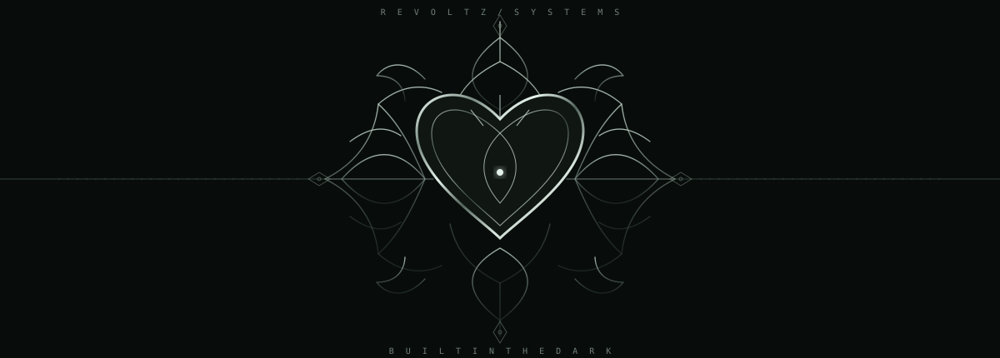

<div align="center">




<br/>

<sub>〔 REVOLTZ SYSTEMS 〕 · PRIVATE INSTANCE · EST. IN PROGRESS</sub>

<br/><br/>

<a href="https://instagram.com/revoltz.ai"></a>
<a href="https://github.com/revoltz-agency"></a>


</div>

---

<div align="center">

<sub>01 / IDENTITY RECORD</sub>

# L X S H X Y A

**FOUNDER · AI & SaaS BUILDER**

<sub>AN OPERATOR BUILDING QUIETLY AT THE EDGE OF WHAT'S NEXT.</sub>

</div>

```text
┌──────────────────────────────────────────────────────────────┐
│  REVOLTZ :: BOOT SEQUENCE                                    │
├──────────────────────────────────────────────────────────────┤
│  [ OK ]  INITIALIZING CORE                                   │
│  [ OK ]  IDENTITY ................. LXSHXYA                  │
│  [ OK ]  ACCESS .................. RESTRICTED                │
│  [ OK ]  CREATIVE DIRECTIVE ...... BUILD                     │
│  [ OK ]  ACTIVE SYSTEMS .......... REVOLTZ / DINETAP          │
│                                                              │
│  STATUS: BUILDING                                            │
│  MODE:   SILENT                                               │
│  INPUT:  IDEAS                                               │
│  OUTPUT: PRODUCTS                                            │
│                                                              │
│  AWAITING NEXT COMMAND_                                      │
└──────────────────────────────────────────────────────────────┘
```

I’m interested in ambitious ideas, difficult problems and turning concepts into useful products. My work sits around AI, SaaS and startups — learning by building, testing and refining.

<div align="center">
<sub>NO NOISE. NO SHORTCUTS. JUST THE WORK.</sub>
</div>

---

<div align="center">

<sub>02 / ACTIVE PROJECT DIRECTORY</sub>

## `/root/projects`

<sub>TWO ACTIVE SYSTEMS · MORE IN DEVELOPMENT</sub>

</div>

<table>
<tr>
<td width="50%" valign="top">

**[01] / DINETAP.exe**

<sub>RESTAURANT OPERATIONS · SAAS</sub>

A QR-based ordering experience designed to make dining simpler and restaurant operations smoother.

<a href="https://dinetap-by-revoltz.onrender.com/"></a>

</td>
<td width="50%" valign="top">

**[02] / REVOLTZ_AI.exe**

<sub>AI · SOFTWARE · DIGITAL EXPERIENCES</sub>

An independent technology venture exploring intelligent tools, AI-powered solutions and software products.

<a href="https://revoltz-agency.github.io/Revoltz/"></a>

</td>
</tr>
</table>

<div align="center">
<sub>03 / SYSTEM MODULES</sub>

## `capabilities --load`

</div>

```bash
$ system.modules --list

[01]  AI & PRODUCT BUILDING
[02]  SAAS / STARTUP EXPLORATION
[03]  SOFTWARE DESIGN & EXPERIMENTATION

$ tools --available

[+]  CODEX
[+]  CLAUDE

$ system.status
[ACTIVE]  LEARNING
[ACTIVE]  BUILDING
[ACTIVE]  REFINING
```

---

<div align="center">

<sub>04 / CONNECTION PORTS</sub>

## `establish_connection()`

For ideas, collaborations or conversations:

<a href="https://instagram.com/revoltz.ai"></a>
<a href="https://github.com/revoltz-agency"></a>

<br/><br/>


<sub>BUILT IN THE DARK.</sub>

<br/>

<sub>TERMINATING SESSION ... [ COMPLETE ]</sub>

</div>
