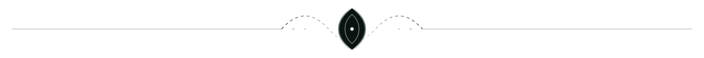

<div align="center">





<br/>

<a href="https://instagram.com/revoltz.ai"></a>
<a href="https://github.com/revoltz-agency"></a>


</div>



<div align="center">

<sub>01 / THE OPERATOR</sub>

# L X S H X Y A

**FOUNDER · AI & SAAS BUILDER**

*BUILT IN THE DARK.*

<sub>Ideas become systems. Systems become products.</sub>

</div>

I’m drawn to ambitious ideas, difficult problems and the process of turning concepts into useful products. Exploring AI, SaaS and startups by building, testing and refining.


<div align="center">

<sub>02 / ACTIVE EXPERIMENTS</sub>

## THE PROJECT VAULT

<sub>SELECTED SYSTEMS FROM THE REVOLTZ WORKSHOP</sub>

</div>

<table>
<tr>
<td width="50%" valign="top">

<div align="center">

### 01 — DINETAP

<sub>RESTAURANT TECHNOLOGY / SAAS</sub>

</div>

A QR-based ordering platform built to simplify the guest experience and streamline restaurant operations.

<div align="center">

<a href="https://dinetap-by-revoltz.onrender.com/"></a>

</div>

</td>
<td width="50%" valign="top">

<div align="center">

### 02 — REVOLTZ AI

<sub>ARTIFICIAL INTELLIGENCE / SOFTWARE</sub>

</div>

An independent technology venture exploring AI-powered solutions, intelligent tools and digital experiences.

<div align="center">

<a href="https://revoltz-agency.github.io/Revoltz/"></a>

</div>

</td>
</tr>
</table>


<div align="center">

<sub>03 / INSTALLED MODULES</sub>

## THE TOOLCHAIN

</div>

```bash
$ modules --list

  AI & PRODUCT BUILDING
  SAAS / STARTUP EXPLORATION
  SOFTWARE DESIGN & EXPERIMENTATION

$ tools --scan

  [ ONLINE ]  CODEX
  [ ONLINE ]  CLAUDE

$ operator --status

  LEARNING     ██████████  ACTIVE
  BUILDING     ██████████  ACTIVE
  REFINING     ██████████  ACTIVE
```


<div align="center">

<sub>04 / OPEN CHANNEL</sub>

## ESTABLISH CONNECTION

For ideas, collaborations or conversations:

<a href="https://instagram.com/revoltz.ai"></a>
<a href="https://github.com/revoltz-agency"></a>

<br/>

<sub>NO NOISE. NO SHORTCUTS. JUST THE WORK.</sub>


<sub>BUILT IN THE DARK.</sub>

<sub>SESSION CLOSED · UNTIL THE NEXT CREATION</sub>

</div>
